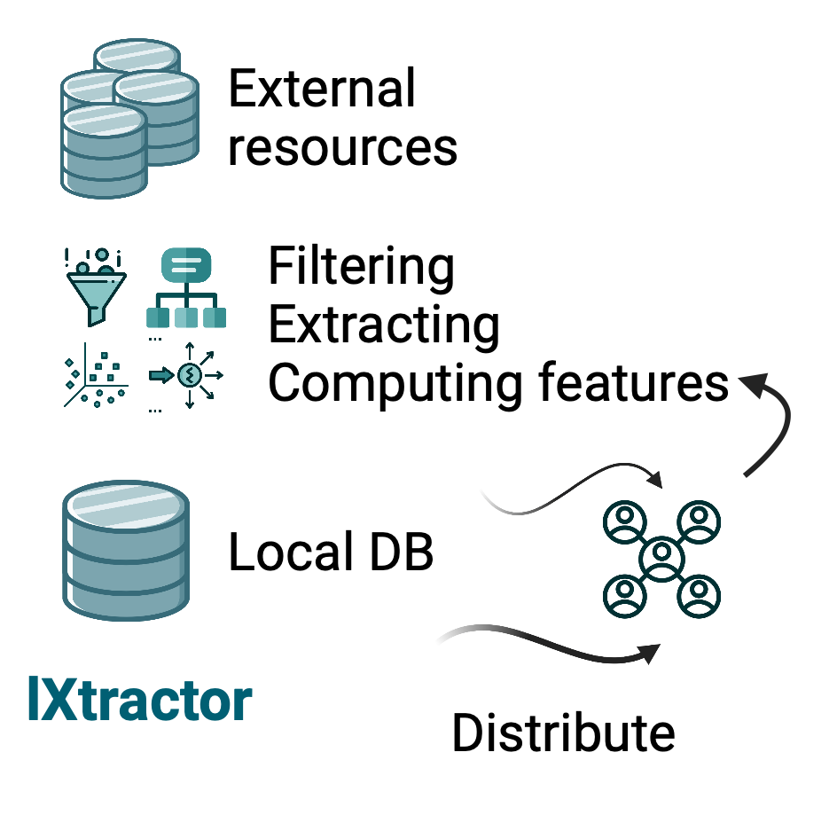

# lXtractor

[](https://coveralls.io/github/edikedik/lXtractor?branch=master)
[](https://lxtractor.readthedocs.io/en/latest/?badge=latest)
[](https://pypi.org/project/lXtractor)
[](https://pypi.org/project/lXtractor)
[](https://github.com/pypa/hatch)



`lXtractor` is a toolbox for feature extraction from macromolecular sequences
and structures. It builds local, shareable data collections anchored to a
reference object (a single sequence, an MSA, or an HMM profile) so that every
sequence and structure in the collection shares a common numbering.

This makes the extracted features directly comparable across entries and
interpretable in downstream analyses, such as fitting interpretable ML
models. `lXtractor` doesn't introduce novel algorithms; it provides a
transparent interface to routine tasks:

- fetching sequences and structures from PDB, SIFTS, and UniProt;
- annotating domains with HMM profiles (via PyHMMer) or alignments;
- mapping numbering between sequences, structures, and reference objects;
- extracting segments, ligands, pockets, and interfaces;
- computing sequence and structure variables into tidy tables;
- saving and loading collections in a structured on-disk format.

## Installation

`lXtractor` requires Python ≥ 3.10 on Linux or macOS.

```bash
pip install lXtractor
```

Some functionality relies on external tools that must be available in
`PATH`:

| Tool                                                | Used for                                   |
|-----------------------------------------------------|--------------------------------------------|
| [MAFFT](https://mafft.cbrc.jp/alignment/software/)  | Sequence alignment and numbering mapping   |
| [DSSP](https://github.com/PDB-REDO/dssp) (`mkdssp`) | Secondary structure assignment (optional)  |

## Quick start

```python
from pathlib import Path

from lXtractor.chain import ChainStructure
from lXtractor.core import GenericStructure
from lXtractor.variables import Dist, GenericCalculator, Manager, PseudoDihedral, SeqEl

# Read a structure and split it into single-chain objects
structure = GenericStructure.read(Path("1aki.pdb"))
chains = [ChainStructure(c) for c in structure.split_chains(polymer=True)]

# Extract a segment by its residue numbering
segment = chains[0].spawn_child(1, 40)

# Define sequence and structure variables
variables = [
    SeqEl(1),
    Dist(1, 40, "CA", "CA"),
    PseudoDihedral(1, 2, 3, 4),
]

# Calculate and aggregate results into a pandas DataFrame
manager = Manager()
results = manager.calculate([segment.seq, segment], variables, GenericCalculator())
df = manager.aggregate_from_it(results)
```

## Core concepts

| Object             | Description                                                               |
|--------------------|---------------------------------------------------------------------------|
| `ChainSequence`    | A polymer sequence with additional aligned sequences ("maps"), e.g., numberings. |
| `GenericStructure` | A wrapper around `biotite`'s `AtomArray` with annotated polymers, ligands, and solvent. |
| `ChainStructure`   | A single-chain structure linked to its `ChainSequence`.                   |
| `Chain`            | A canonical `ChainSequence` with mapped `ChainStructure` objects.         |
| `ChainList`        | A list-like container for filtering and bulk operations on chains.        |
| `ChainIO`          | Reading and writing chains to disk.                                       |
| `Manager`, `GenericCalculator` | Staging, parallel calculation, and aggregation of variables.  |

All `Chain*` objects support parent-child hierarchies: segments spawned via
`spawn_child()` retain a link to their origin and can be mapped back to it.

## Typical workflow

1. **Assemble the data** using `PDB`, `SIFTS`, `UniProt`, or local files.
2. **Map a reference** onto the assembled sequences with `PyHMMer` or
   `Alignment`, producing `ChainSequence`, `ChainStructure`, or `Chain`
   objects, depending on the data at hand.
3. **Filter** the results, typically via `ChainList.filter()`.
4. **Calculate variables** with `Manager` and `GenericCalculator`, obtaining
   a `pandas.DataFrame`.
5. **Save** the collection with `ChainIO` for later reuse or modification.

For larger datasets, `lXtractor.collection` provides constructors that run
this workflow in batches, storing the results in a SQLite-backed collection.

## Examples

- [Finding sequence determinants](https://eboruta.readthedocs.io/en/latest/notebooks/sequence_determinants_tutorial.html)
  of tyrosine and serine-threonine kinases.
- [Building a structural collection](https://github.com/edikedik/kinactive/blob/abae9c8a1fca0754d02e3f117dee210b587e666b/kinactive/db.py#L142)
  of protein kinase domains.

See the [documentation](https://lxtractor.readthedocs.io) for the API
reference.

## Status

`lXtractor` is in the alpha stage of development, and its interfaces may
change between releases. The `AlphaFold` interface is deprecated and will be
removed in a future release.
